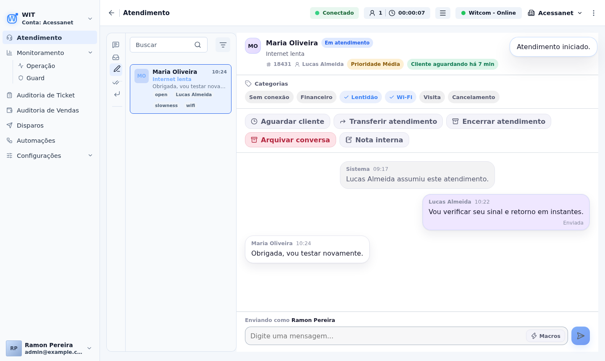
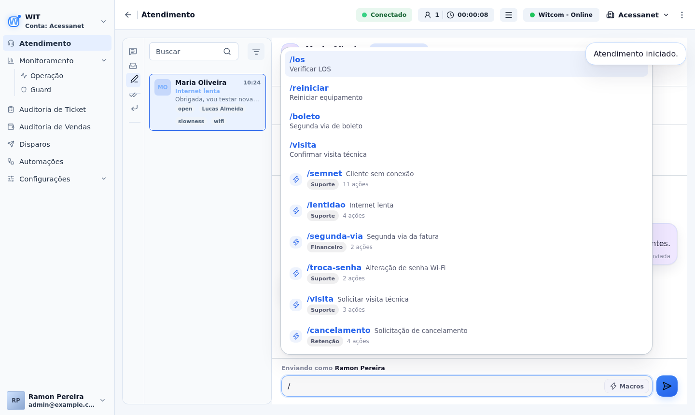
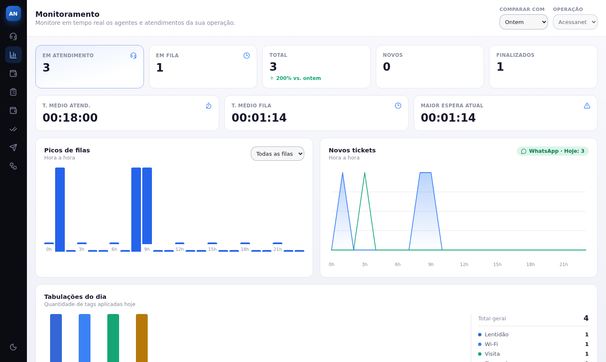
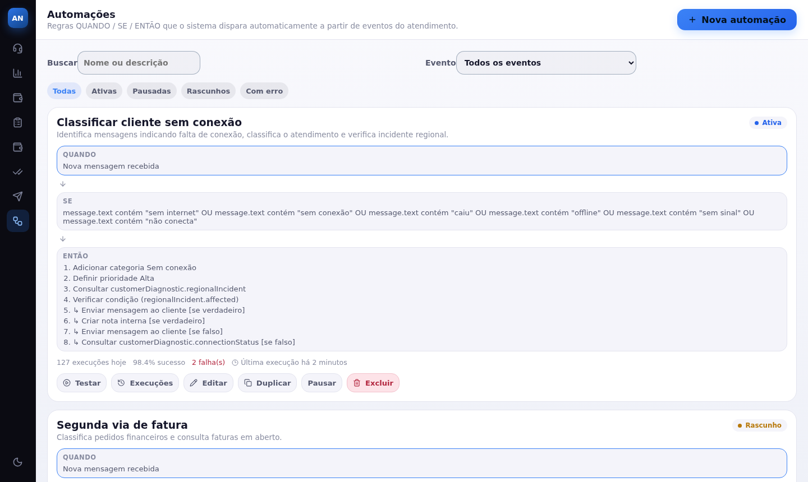
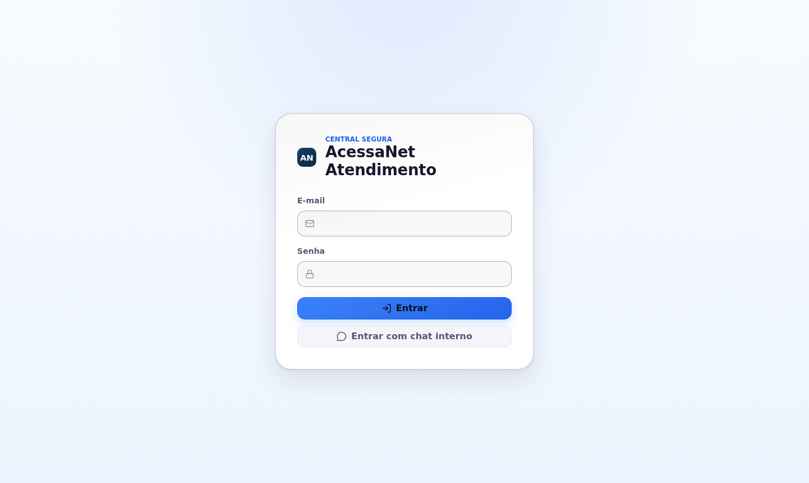

<div align="center">

# Support Console

**Painel de atendimento em tempo real para equipes de suporte.**
Fila, chat com o cliente, macros, automações e monitoramento em uma única tela.




</div>

---

## O que é

O **Support Console** é um painel web em que os atendentes respondem, em tempo real, clientes que conversam pelo chat de um aplicativo mobile. Ele é **somente frontend**: não acessa banco de dados nem sistemas internos. Toda a comunicação passa por uma única API de chat, o que mantém a superfície de ataque pequena.

Foi construído para uma operação de suporte de um provedor de internet, mas a arquitetura serve para qualquer equipe de atendimento por chat.

## Destaques

- **Conversas em tempo real** com Socket.IO: novas mensagens, "digitando…", leitura, transferências e encerramentos chegam sem recarregar a página.
- **Fila inteligente.** Filtros, busca, contadores, prioridade automática e **SLA visual** do tempo de espera do cliente. Dá para ordenar por prioridade, SLA, não lidas, recentes ou antigas.
- **Categorias por conversa** (sem conexão, financeiro, lentidão, Wi-Fi, visita, cancelamento), editáveis pelo atendente.
- **Macros.** Sequências de ações executadas em ordem dentro do atendimento, acionadas por atalho digitando `/`.
- **Automações.** Regras `QUANDO → SE → ENTÃO` que o próprio sistema dispara a partir de eventos, sem ação do atendente.
- **Monitoramento** da operação: indicadores, picos de fila, novos tickets por hora e tabulações do dia.
- **Auditoria** de tickets e de vendas, **disparos** de campanhas e lista de **finalizados**.
- **Controle por cargo** (atendente, supervisor e admin) e status de disponibilidade do atendente.
- **Envio confiável.** Cada mensagem tem um identificador único, com estados "enviando", "enviada" e "falha" com nova tentativa.
- **Experiência cuidada:** tema claro e escuro, sons e notificações opcionais, contador de não lidas no título da aba, esqueletos de carregamento e erros amigáveis.

## Telas

<table>
  <tr>
    <td align="center"><br><sub><b>Macros e respostas rápidas</b> com <code>/</code></sub></td>
    <td align="center"><br><sub><b>Monitoramento</b> da operação</sub></td>
  </tr>
  <tr>
    <td align="center"><br><sub><b>Automações</b> QUANDO → SE → ENTÃO</sub></td>
    <td align="center"><br><sub><b>Login</b> com opção de entrar pelo chat interno</sub></td>
  </tr>
</table>

> As capturas foram feitas em **modo de demonstração**, com dados fictícios.

## Macros e automações

| | Resposta rápida | Macro | Automação |
|---|---|---|---|
| **Quem inicia** | Atendente | Atendente | O sistema |
| **O que faz** | Insere um texto pronto | Executa uma sequência de ações | Executa ações quando um evento acontece |
| **Exemplo** | `/boleto` | `/semnet`: classifica, consulta diagnóstico e responde | Mensagem com "sem internet" classifica o ticket sozinha |

**Ações suportadas:** enviar mensagem, adicionar ou remover categoria, definir prioridade, nota interna, transferir para fila, aguardar, consulta a API e **condições** com ramificação.

**Segurança das ações:**
- Os textos usam variáveis como `{{customer.name}}` com um renderizador próprio, **sem `eval`**.
- Uma consulta a API **nunca aceita uma URL vinda do frontend**: ela só referencia uma operação pré-autorizada no backend.
- Criar, editar e excluir macros exige cargo de **supervisor** ou **admin**.

## Segurança

- **Sessão decidida pelo servidor.** As rotas protegidas consultam `GET /api/agent/auth/me`. Dado salvo no navegador não autentica ninguém.
- **Cookie HttpOnly** (`credentials: "include"`), e o token de acesso, quando existe, fica **só em memória**.
- **Dados sensíveis mascarados**, como o CPF do cliente.
- **Ações sensíveis com confirmação**, como transferir e excluir. A transferência só aparece para supervisor e admin.
- **O build de produção falha** se o modo de demonstração estiver ligado.
- **Sem acesso direto a banco ou a sistemas internos.**

## Stack

| Camada | Tecnologias |
|---|---|
| Interface | React 19, TypeScript, React Router 7, Lucide Icons, CSS próprio |
| Tempo real | Socket.IO Client, com implementação real e um simulador para demonstração |
| Build e qualidade | Vite 8, TypeScript (com checagem de variáveis e parâmetros não usados), Oxlint |

## Como rodar

Requer Node.js 20.19 ou superior.

```bash
git clone https://github.com/Olukasao/support-console-App_de_Atendimento_ao_Cliente.git
cd support-console-App_de_Atendimento_ao_Cliente
npm install
```

### Modo de demonstração (não precisa de backend)

```bash
VITE_USE_MOCK=true npm run dev
```

Abra o endereço mostrado no terminal e entre com **qualquer e-mail e senha**. O cargo depende do e-mail: um que contenha `admin` entra como administrador, `supervisor` como supervisor e os demais como atendente. Depois, clique em **Iniciar Atendimento**.

### Com uma API real

```bash
cp .env.example .env.local     # aponte VITE_CHAT_API_URL para a sua API
npm run dev
```

| Variável | Função |
|---|---|
| `VITE_CHAT_API_URL` | Endereço da API de chat. Vazio usa caminhos relativos, útil com proxy reverso. |
| `VITE_USE_MOCK` | `true` liga o modo de demonstração (só em desenvolvimento). |

### Scripts

| Comando | Função |
|---|---|
| `npm run dev` | Servidor de desenvolvimento |
| `npm run build` | Verificação de tipos e build de produção |
| `npm run typecheck` | Só a verificação de tipos |
| `npm run lint` | Análise estática com Oxlint |
| `npm run preview` | Serve o build gerado |

## Estrutura

```text
src/
  pages/        telas (atendimento, monitoramento, automações, auditoria…)
  components/   chat, macros, automações, layout e rotas protegidas
  services/
    api/        clientes REST centralizados
    socket/     Socket.IO real e simulado
  hooks/        autenticação, macros, automações, notificações, tema
  context/      sessão e tema
  mocks/        servidor simulado para o modo de demonstração
  utils/        SLA, prioridade, categorias, segurança e validações
docs/           contrato da API e mídias do README
scripts/        deploy e servidor de testes
```

## Documentação técnica

O contrato completo com a API, os eventos de Socket.IO, os fluxos implementados e as pendências de backend estão em [docs/INTEGRATION.md](docs/INTEGRATION.md).

## Estado do projeto

O frontend está completo e funciona de ponta a ponta no modo de demonstração. Para uso real, ele depende de uma API de chat com o contrato descrito na documentação. Alguns recursos de macros e automações dependem de endpoints de backend que ainda não existem. Enquanto isso, a ação falha de forma visível e nunca simula sucesso.

## Licença

Projeto proprietário, publicado para fins de portfólio. Sem autorização, não copie, redistribua nem use comercialmente.
